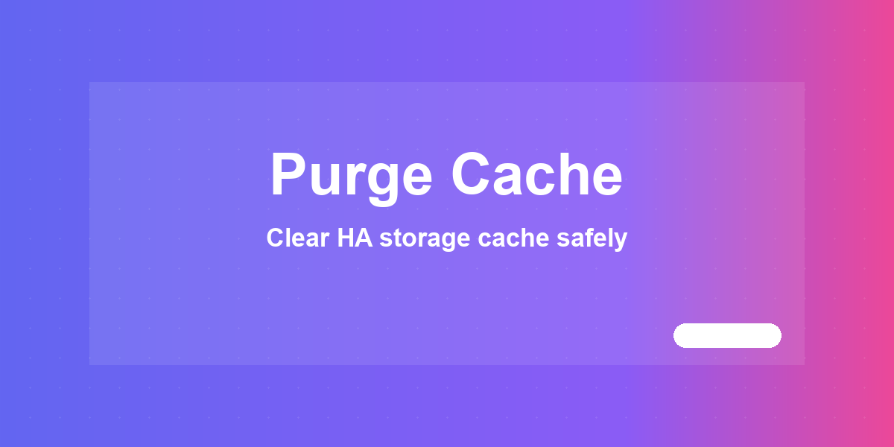
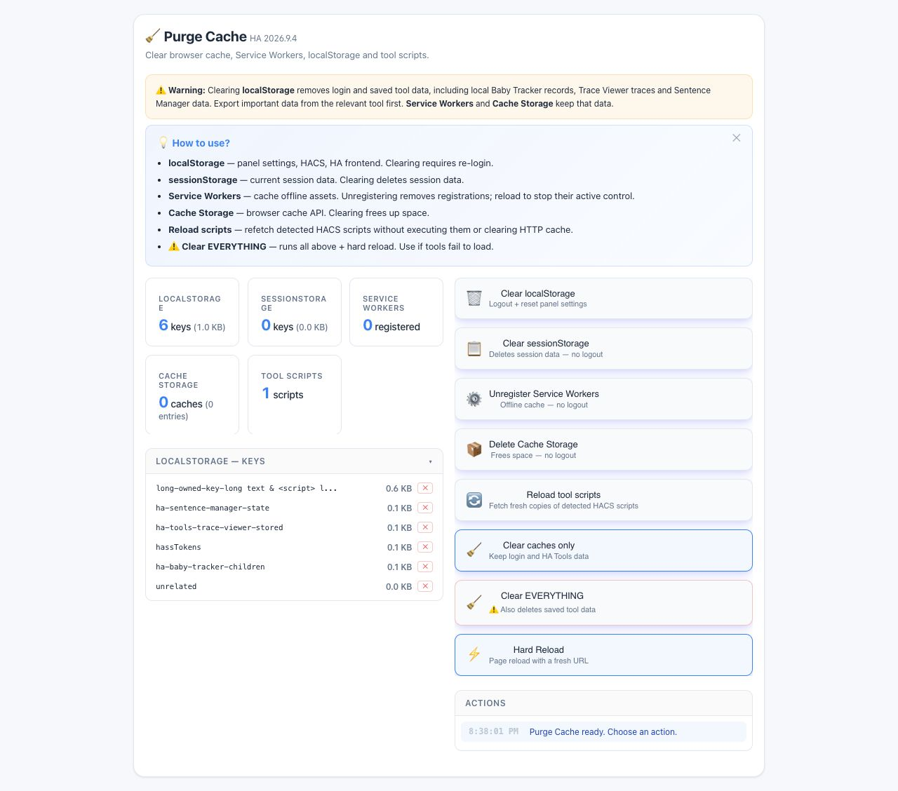
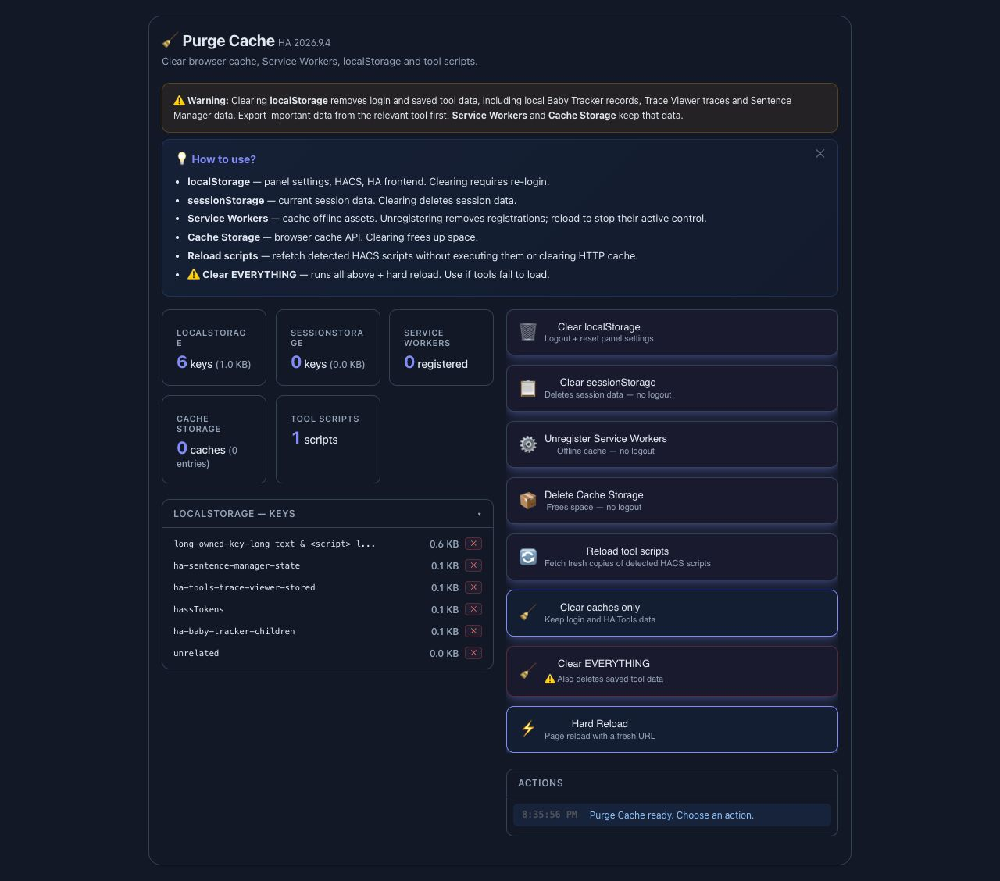

# Purge Cache



Inspect and clear this browser's storage from a Home Assistant card. Choose a
storage area, review what was actually removed, and decide when to reload.

[](https://github.com/MacSiem/ha-purge-cache/releases) [](LICENSE)

## How it works

1. **Inspect browser storage.** See localStorage and sessionStorage key counts,
   Service Worker registrations and Cache Storage. Expand the localStorage list
   to inspect key names and estimated sizes or delete one selected key.
2. **Choose the scope.** Each storage area has its own action. **Clear caches
   only** removes Service Worker registrations and Cache Storage while retaining
   login and localStorage/sessionStorage data. **Clear EVERYTHING** also removes
   localStorage and sessionStorage and refetches detected tool scripts.
3. **Review the result.** Each selected area reports before, after, confirmed
   removals, failures and unknown outcomes in its own units. Removed key/cache
   names stay in the current card session; values are not included. Unselected
   areas are explicitly marked as not checked.
4. **Reload when ready.** Cleanup leaves its result visible. **Hard Reload** is a
   separate confirmed action. An incomplete or unconfirmed selected action
   blocks that button so a reload cannot hide its result.

Success requires both the deletion acknowledgement and an independent readback.
Partial results, failures and unknown outcomes remain distinct. Missing or denied
browser APIs are unavailable, never a measured zero. A new entry created during
cleanup is reported separately. The normal HTTP cache remains unconfirmed:
browser JavaScript cannot verify that it was cleared.

Cleanup captures at most 512 entries per storage area, with identifiers up to
2,048 characters. If a reliable bounded snapshot cannot be read, that area is not
mutated and its outcome stays unknown. Purge Cache's two instruction/support
dismissal preferences are preserved and counted as excluded when observed.

Actions that delete saved local/session data, individual keys, or one selected
worker/cache area ask for confirmation. **Clear caches only** acts directly on
cache APIs and preserves saved local/session data. Confirmation starts on Cancel;
Escape cancels, and Tab, Enter and Space work from the keyboard. Cleanup never
runs merely because the card is opened or updated.

All operations use the current browser and Home Assistant origin. Household
members can maintain their own browser storage, including while HA is offline.
Changing the active account, connection or card configuration discards private
results and prevents remaining steps of an old request from continuing. Nothing
changes HA server configuration, automations or history.

## Screenshots

| Light | Dark |
|---|---|
|  |  |

*Synthetic browser storage stats, the localStorage key browser, separate
cache-only action and explicit warning before deleting saved tool data. Dark
mode follows your Home Assistant theme.*

## Installation

1. Open HACS → Custom repositories.
2. Add `https://github.com/MacSiem/ha-purge-cache` as category **Dashboard**
   (Lovelace plugin).
3. Install **Purge Cache** and reload your browser.

## Quick start

```yaml
type: custom:ha-purge-cache
```

No options are required. Optional configuration:

```yaml
type: custom:ha-purge-cache
title: Browser maintenance
show_support: false
inspect_cache_entries: false
```

`inspect_cache_entries` defaults to `true` and counts entries by opening existing caches. A cache removed concurrently can be recreated by that inspection. Set it to `false` to read cache counts only. Deletion results never open caches to count their entries. This option is also available in the visual editor.

`title` is shown literally and wraps within the card. `show_support: false` hides the optional administrator-only support link. You can also dismiss the instructions and support link in the card; dismissal persists when browser storage is available.

## Updating from 4.1.x

Update through HACS and reload the frontend so it loads the new JavaScript. The
card type, title and support settings are unchanged; there is no server-side
migration. Browser data is preserved by the update itself. The main behavior
change is that cleanup leaves a measured result on screen instead of reloading
automatically. Review it, then use the separate Hard Reload action if needed.

Purge Cache keeps only its dismissal preferences in localStorage. Action results
and their key names are held in memory and disappear on reload or context change.
Export important records from the tool that owns them before choosing a broader
storage deletion. Rolling back the card version cannot restore deleted data.

## FAQ

**When do I need this?**
When a dashboard or HA Tools card won't pick up an update, a panel misbehaves
after an upgrade, or you want to reset frontend state without digging through
browser devtools.

**Will I get logged out?**
Only if you clear **localStorage** (your HA login token lives there) or use
**Clear EVERYTHING**. Both can also erase local Baby Tracker records, saved
Trace Viewer traces, Sentence Manager data and other browser-only data. Use **Clear caches only** to
retain these. Browser Cache Storage is separate from the normal HTTP cache;
if a HACS JavaScript update still appears stale, update its Lovelace resource
URL or reload the frontend after HACS changes it.

**Does it change anything on my HA server?**
No. All actions are strictly browser-side; your configuration, automations
and history are untouched.

**Does this send data anywhere?**
Storage keys and values are not uploaded. The card has no telemetry or CDN assets. Reload tool scripts only refetches detected JavaScript from your own HA origin with `cache: no-store`; it does not execute those copies or clear the normal HTTP cache.

## Changelog

See [CHANGELOG.md](CHANGELOG.md).

## Support

- [Buy Me a Coffee](https://buymeacoffee.com/macsiem)
- [PayPal](https://www.paypal.com/donate/?hosted_button_id=Y967H4PLRBN8W)

The optional in-card support link is shown only to administrators. Dismiss it in the card or set `show_support: false` in the card configuration.

## License

MIT, see [LICENSE](LICENSE).

## Privacy and data

The card inspects browser storage for this Home Assistant origin. The cache-only action preserves localStorage; broader deletion choices can remove data saved by other cards. Read the confirmation and export important data first. Storage keys and values may contain private household information.

See [SECURITY.md](SECURITY.md) for safe vulnerability reporting and [NOTICE](NOTICE) for licensing notices.
